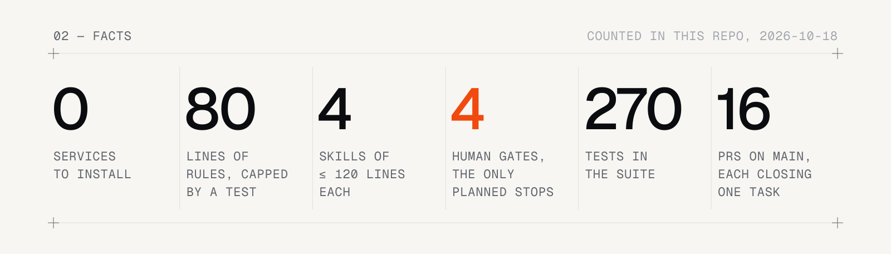
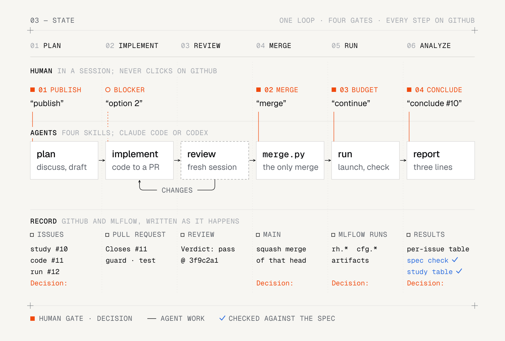
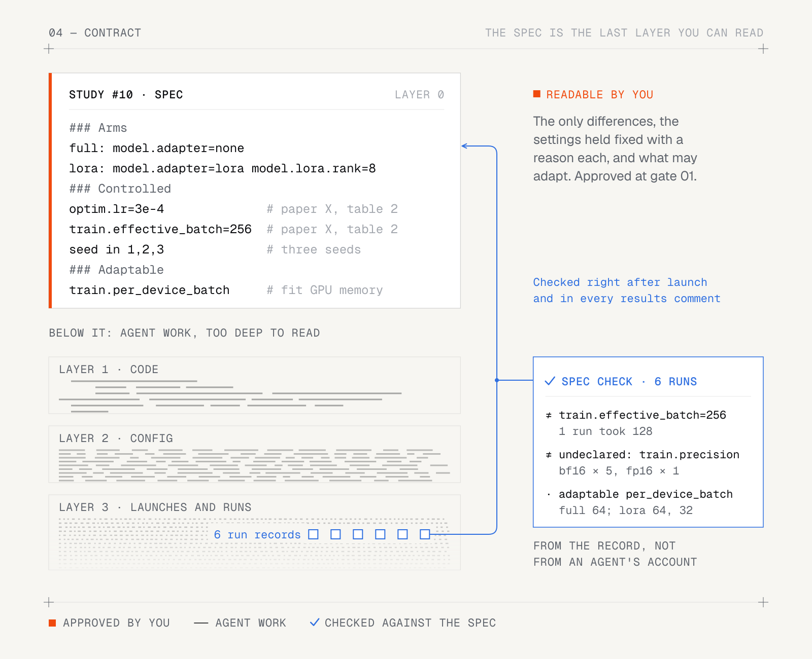
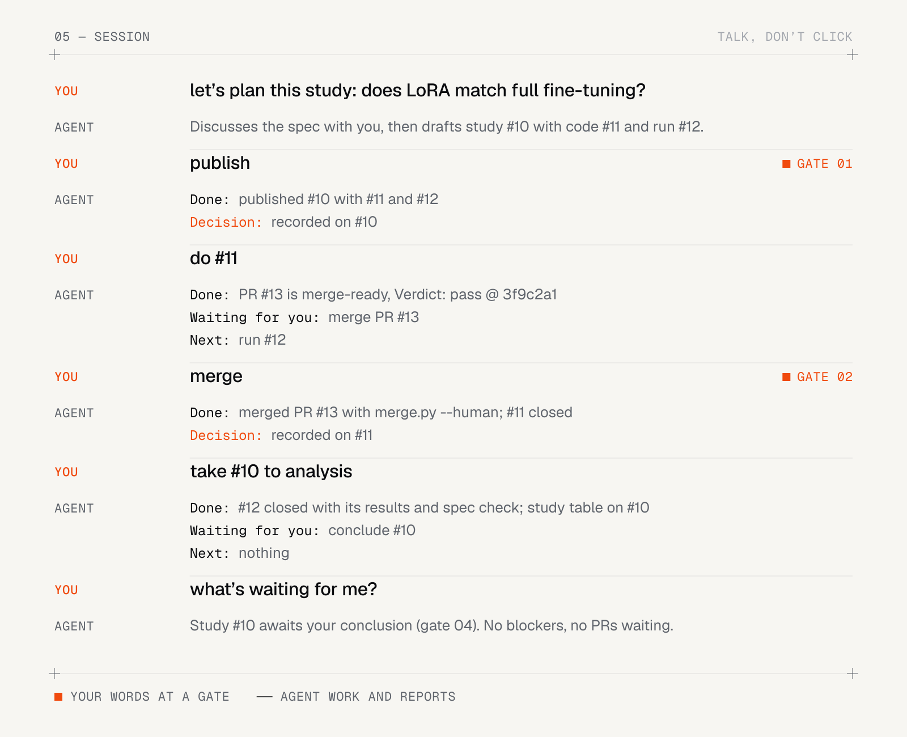

<picture>
  <source media="(prefers-color-scheme: dark)" srcset="assets/hero-dark.svg">
  
</picture>

**让编码 agent 推进你的机器学习研究，同时让每个对比都公平。**

rh 是一套模板，复制进研究仓库就能用。状态放在 GitHub issue 里，步骤写在一个规则文件和四个 skill 里；每个 run 都按它自己的记录，对照你批准的研究规格核对。没有要安装的东西。

    

[English](../README.md) · [接入 rh](#接入-rh) · [设计文档](design/2026-10-16-harness-v1.md)

## 为什么要 rh

编码 agent 写代码、启动运行、贴出结果的速度，已经快过人能读完的速度。风险在计划以下的那几层。为了修一次崩溃改了学习率，为了塞进显存把有效 batch 减半。每一处单看都合理，合在一起，对比就成了猜测。而你通常只看到 agent 的总结。

rh 让人只待在需要人的地方，其余的都能核对。你批准一份研究规格：各组（arm）之间的不同、固定不变的设置（各带理由）、可以调整的设置。规格以下的事都由 agent 通过 issue 和 PR 去做。它们只在四个关口停下，或者在自己解决不了的卡点停下。每个 run 都记下解析后的配置，结果命令拿这些记录对照规格核对。所以偏差是以事实的形式交到你手上，而不是 agent 的说法。

它是一套围绕 git 和 GitHub 的约定，不是一个服务。你复制进去的是一个规则文件、四个 skill、几个 issue 表单、一个 PR 检查、一个合并脚本，和两个运行用的参考脚本。除了 GitHub、git 和你自己的机器，不需要别的东西。

<picture>
  <source media="(prefers-color-scheme: dark)" srcset="assets/stats-dark.svg">
  
</picture>

rh 本身就是用 rh 开发的。从第一个提交之后，main 上的每次改动都是一个 squash 合并的 PR，关闭 `plan` 父 issue 下的一个任务 issue。

## 怎么运作

<picture>
  <source media="(prefers-color-scheme: dark)" srcset="assets/loop-dark.svg">
  
</picture>

- **状态机是 GitHub issue。** 研究（`study`）和开发计划（`plan`）是父 issue，下面挂 `code` 和 `run` 子 issue。依赖、关联分支、PR、检查和关闭状态都用 GitHub 原生字段表达，另外只加一个 `needs-decision` label。仓库里没有计划、进度或笔记文件。
- **规则是 AGENTS.md**，最多 80 行。状态怎么判断、什么时候必须停、怎么提问、Git 和文件怎么用，都写在里面。
- **步骤是 skill。** `plan`、`implement`、`review`、`run` 四个 skill 各写清一个角色从头到尾怎么做，每个最多 120 行。Claude Code 和 Codex 读的是同一套文件。
- **能机械检查的，就机械检查。** guard 检查 PR 的格式、文件位置和改动范围；`test` 跑项目自己的测试；merge.py 是 agent 唯一的合并入口。
- **每个 PR 都由新会话审查。** 审查者只拿到 PR 编号，自己去读 PR、它关闭的 issue、相关的 Decision，父 issue 是研究时还读它的规格；不看实现者的会话。它贴一条评论，第一行是 `Verdict: pass @ <sha>` 或 `Verdict: changes @ <sha>`。
- **运行记录是 MLflow run**，带出处（issue、命令、commit、环境和数据指纹）和解析后的配置。结果评论由脚本从这些记录生成。MLflow 的网页可以用来浏览记录，但不是必需的。

每条指令就是一个目标状态。agent 一直推进，到达目标、碰到关口或遇到卡点时才停。一切顺利也要在四个关口停下：

| 关口 | 什么时候 | 你说什么 |
|---|---|---|
| **01&nbsp;发布** | 新增或改变已批准的工作：发布计划；改任务的 Goal、Scope、Acceptance 或 Merge，或研究的 Arms、Controlled、Adaptable；改受保护路径 | "发布" |
| **02&nbsp;合并** | PR 待合并时，除非任务写了 `Merge: agent`。那时 agent 自己用 merge.py 合并；碰了受保护路径、或当前 head 没有审查通过的，merge.py 会拒绝 | "合并"，或"合并 `#15`" |
| **03&nbsp;预算** | 下一步会超出预算：token、时间或 GPU 小时 | "继续"，也可以给个新预算 |
| **04&nbsp;下结论** | 研究的子 issue 全部关闭，进入待分析 | 你的结论，例如"`#10` 下结论：……" |

**卡点。** 遇到以下情况，agent 也会停下：
- 同一个失败连续 3 次；
- 审查连续 3 次给出 changes；
- 目标有歧义，而且会影响交付物；
- 某个 Controlled 设置不改变对比就满足不了。

agent 只问一次，带上证据、最多 3 个选项和推荐。你在会话里，就当场问；不在时给 issue 打上 `needs-decision`，贴一条四行的卡点评论（`Blocked:`、`Evidence:`、`Options:`、`Recommend:`），然后转去做别的就绪任务。测试失败、合并冲突、范围内的 bug 这类事，agent 自己处理，不来问。

## 规格就是合同

<picture>
  <source media="(prefers-color-scheme: dark)" srcset="assets/contract-dark.svg">
  
</picture>

批准研究时，你读的是它的规格：一张只有几个变量的公平对比表。规格下面的代码、配置和启动越来越多，多到没人读得完，设置上的差异也正是从这里冒出来的。规格是你能真正核对的那一层。所以 rh 按每个 run 自己的记录对照规格检查，而不是听 agent 怎么说。

规格是研究 issue 里的三节，每行一项：

```
### Arms
full: model.adapter=none
lora: model.adapter=lora model.lora.rank=8

### Controlled
data.split=val  # held-out split from data.sha256
model.backbone=vit_b16  # paper X, Table 2
optim.lr=3e-4  # paper X, Table 2
train.epochs=30  # paper X, Table 2
train.effective_batch=256  # paper X, Table 2
seed in 1,2,3  # three seeds, as in paper X

### Adaptable
train.per_device_batch  # fit to GPU memory; effective batch stays 256
train.accum  # follows per_device_batch
```

- **Arms**：各组之间仅有的不同。
- **Controlled**：`key=value  # 理由` 是每个 run 都要取的值；`key in v1,v2,...  # 理由` 是每组都要跑遍的值，例如 seed 和调参网格。理由必填：一篇论文、一条记录或之前的一个结果。
- **Adaptable**：可以因 run 而不同的工程设置，各带一条保证对比不被破坏的规则。
- **键**是每个 run 解析后配置的点号键。训练代码把配置写到 `$RUN_DIR/config.json`，`run.py` 一能解析就把它记成 `cfg.*` 参数，所以还在跑的 run 也能核对。

`run` skill 在启动后马上核对一次，停掉违反规格的 run。每条结果评论的最后都有一节 `规格核对`，按事实列出：
- 不满足某条 Controlled 的 run，或没记录这个键的 run；
- 不属于任何 arm、或属于多个 arm 的 run；
- 缺了某条 `in` 中某些值的 arm；
- 不在任何一节、取值却不同的键（`未声明的差异`）；
- 没有 run 的 arm；
- 每个 Adaptable 键在各 arm 取过的值。

研究的 run issue 全部关闭后，整个研究的总表和核对也会贴到研究 issue 上。

下面是 `scripts/results.py` 对上面这份规格的六个玩具 run 的真实输出。其中一个 lora run 用了更小的每卡 batch 和 fp16。结果文字跟随项目的语言，本仓库是中文。

> 规格核对：
> - `train.effective_batch=256` 不成立：1 个 run，0330bc8a46094e03a875e72c6dfd0872（128）
> - 未声明的差异 `train.precision`：bf16（5 个 run）、fp16（1 个 run）
> - Adaptable `train.per_device_batch`：full 取 64（3 个 run）；lora 取 64（2 个 run）、32（1 个 run）
> - Adaptable `train.accum`：full 取 4（3 个 run）；lora 取 4（3 个 run）

<details>
<summary>完整的结果评论</summary>

> `#12` 的结果：6 个 run，3 组，按去掉 seed 的命令分组。
>
> | 命令 | arm | n | 失败数 | top1 均值 | top1 标准差 | commit | 环境锁 | 数据 |
> |---|---|---|---|---|---|---|---|---|
> | `python train.py arm=full` | full | 3 | 0 | 0.8505 | 0.00358 | 7ac858e | 73cb3858 | 无 |
> | `python train.py arm=lora` | lora | 2 | 0 | 0.8424 | 0.004648 | 7ac858e | 73cb3858 | 无 |
> | `python train.py arm=lora batch=32 precision=fp16` | lora | 1 | 0 | 0.8399 | — | 7ac858e | 73cb3858 | 无 |
>
> 标注：
> - 无
>
> 规格核对：
> - `train.effective_batch=256` 不成立：1 个 run，0330bc8a46094e03a875e72c6dfd0872（128）
> - 未声明的差异 `train.precision`：bf16（5 个 run）、fp16（1 个 run）
> - Adaptable `train.per_device_batch`：full 取 64（3 个 run）；lora 取 64（2 个 run）、32（1 个 run）
> - Adaptable `train.accum`：full 取 4（3 个 run）；lora 取 4（3 个 run）

</details>

rh 只报告记录里有什么。这些 run 还能不能比，由你判断。

## 说话，不点页面

<picture>
  <source media="(prefers-color-scheme: dark)" srcset="assets/session-dark.svg">
  
</picture>

你只在 agent 会话（Claude Code 或 Codex）里做决定，不直接操作 GitHub 页面。建 issue、开 PR、审查、合并、关闭都由 agent 按你的指示执行。你做的每个决定，agent 都在相应 issue 上记成一条 `Decision: <选项> — <一行理由>` 评论。你明确下的指令本身就算批准，agent 不会再问一遍。

| 你说 | agent 做什么 |
|---|---|
| "我们计划一下这个研究"、"我想研究 X" | 按 `plan` skill 和你讨论，起草研究、它的规格和子 issue；等你说"发布"才建 issue |
| "发布" | 按波次建父 issue 和子 issue，并记下 Decision |
| "做 `#12`" | 把代码任务推进到待合并：检查全绿、当前 head 有 `Verdict: pass`；任务写了 `Merge: agent` 就推进到合并完成 |
| "合并"，或"合并 `#15`" | 用 `python .github/scripts/merge.py <PR> --human` squash 合并当前 head |
| "把 `#10` 推到待分析" | 一直推进到研究 `#10` 的子 issue 全部关闭 |
| "继续" | 推进到下一个关口 |
| "看看等我的" | 读 GitHub 上的状态，列出带 `needs-decision` 的 issue 和待合并的 PR |

每次停下，agent 都汇报三行，带链接：`Done:`、`Waiting for you:`、`Next:`。可以同时开几个会话，各做一件事。每个任务认领时会建一个关联分支，已经认领的任务，除非指令点名，别的会话不会接手。

## 文件一览

| 文件或目录 | 作用 |
|---|---|
| `AGENTS.md` | agent 的全部规则；最后的 Project 一节由各项目填写 |
| `.agents/skills/{plan,implement,review,run}/SKILL.md` | 四个角色的步骤；Codex 从这里读 skill |
| `.claude/skills` | 指向 `../.agents/skills` 的软链，让 Claude Code 读到同一套 skill |
| `.claude/settings.json` | Claude Code 的 `permissions.deny`：禁止直接运行 `gh pr merge` |
| `.codex/rules/harness.rules` | Codex 的规则：`gh pr merge` 设为 forbidden |
| `.github/ISSUE_TEMPLATE/` | 三种 issue 表单：`study.yml`、`code.yml`、`run.yml` |
| `.github/pull_request_template.md` | PR 正文模板 |
| `.github/guard.toml` | guard 的配置：目录白名单、`.md` 位置、禁用文件名、受保护路径、PR 标题类型、正文行数上限 |
| `.github/scripts/guard.py` | 检查 PR：关闭恰好一个任务 issue、文件位置、不超出 Scope、标题和正文格式 |
| `.github/scripts/merge.py` | agent 唯一的合并入口（规则见[下文](#保持不变的接口)） |
| `.github/workflows/guard.yml` | 用 `pull_request_target` 跑 guard，代码取自 main，不执行 PR 里的代码 |
| `.github/workflows/test.yml` | 在 PR 和推到 main 时跑项目测试 |
| `scripts/run.py` | Run 命令的参考实现：跑一条命令，记成一个 MLflow run，可选按 GPU 排队 |
| `scripts/results.py` | 从一个或几个 issue 的运行记录生成结果表，并按研究规格逐个核对 run |
| `scripts/run.toml` | run.py 的配置：MLflow 实验名、环境锁、数据清单、seed 参数名、GPU 列表、GPU 锁目录 |
| `scripts/setup.sh` | 一次性设置仓库：label、合并方式、main 的分支保护 |
| `tests/` | 以上脚本和规则文件的测试 |
| `docs/` | 人写的设计文档 |
| `.gitignore` | 忽略本地的 MLflow 存储（`mlflow.db*`、`mlartifacts/`、`mlruns/`） |

## 原则

- **GitHub 原生，没有要安装的东西。** 状态都在 issue、PR、检查和分支保护里，别处什么都不存。会话随时可以断，不会丢东西。
- **机制，不是策略。** rh 只记录事实、展示差异。它不定 seed 数，不设计实验，不决定何时重跑，也不判断 run 能不能比，这些由你在规格和指令里定。分析、可视化，以及 agent 在任务内部怎么实现，它也都不管。
- **按高能力模型来写。** 规则短而具体，假定 agent 能遵守写清楚的规则。脚本固化流程，不防御格式错乱、冒充或外人。
- **是模板，不是框架。** rh 不带集群、调度器、存储或跟踪服务的适配器。`run.py` 和 `results.py` 只是单机参考实现。每个接入的项目通过自己的 issue，把集群、调度器（例如 SLURM）和跟踪后端适配到自己的环境，同时守住[保持不变的接口](#保持不变的接口)。

## 接入 rh

下面的事都可以交给会话里的 agent 去做。你只需要拍板，并在需要时提供管理员账号。一共五步，另有一个可选的机器账号。

<details>
<summary><b>1. 复制模板文件</b>，再改 <code>guard.toml</code>、<code>run.toml</code>，并让训练代码输出配置</summary>

只复制被跟踪的文件。这样模板 clone 里未跟踪的本地文件（工具配置、`__pycache__`）不会带过去，`.claude/skills` 软链也会保留：

```
git -C <rh clone> archive HEAD AGENTS.md .agents .claude .codex .github scripts tests | tar -x -C <你的仓库>
```

再把 `.gitignore` 的几行并进去；`tests/` 里用不上的测试可以删掉。记下复制自 rh 的哪个 commit（`git -C <rh clone> rev-parse HEAD`），写进接入提交的信息，以后好对照 rh 的改进同步。
- 改 `.github/guard.toml`：
  - `layout` 加上你的目录（如 `src/**`、`configs/**`），以及项目会改的根目录文件（如 `pyproject.toml`、`uv.lock` 等锁文件、`.python-version`）。漏了的话，改依赖的 PR 会被 guard 拒收。
  - `protected` 加上评测和数据路径。
  - `markdown` 按需调整。
- 改 `scripts/run.toml`：`experiment`、`env_lock`（你的锁文件）、`gpus`。
  - 数据目录通常被 git 忽略，数据指纹因此来自一个被跟踪的数据清单：记着各数据文件校验和的文件，例如 `sha256sum` 的输出存成 `data.sha256`。
  - 把它相对仓库根目录的路径写进 `data_manifest`，并加进 guard.toml 的 `layout` 和 `protected`。
- 让训练代码在启动时把解析后的完整配置写成 JSON 对象，存到 `$RUN_DIR/config.json`，只由一个进程写（例如 rank 0）。
  - 所有可能影响结果的设置都要在里面，包括推导出来的，例如有效 batch。
  - 研究规格里的键就是这份配置展开后的点号键（如 `optim.lr`），结果命令靠它核对每个 run 是否符合规格。
  - 只放会影响结果的设置。输出目录、run 名、时间戳这类每个 run 都不同、又不影响结果的值不要写进去，否则每条结果评论都会把它们列为 `未声明的差异`。确实要放的，在研究规格里声明为 Adaptable。
- 几个用户共用一台机器、`TMPDIR` 又按用户区分时，默认的 GPU 锁目录各在各的 `TMPDIR` 下，互相看不见。把 run.toml 的 `lock_dir` 设成他们都能写的同一个本机目录。
- 已有 CLAUDE.md 的，只把项目事实压缩进 AGENTS.md 的 Project 一节（每个字段一行），其余内容挪到 `docs/` 或代码注释里，然后删掉 CLAUDE.md。harness 只认 AGENTS.md，guard 会拒收别处的 `.md`。

</details>

<details>
<summary><b>2. 填写 AGENTS.md 的 Project 一节</b>，每个字段一行</summary>

其他各节不用改。AGENTS.md 最多 80 行（有测试检查），每个字段只写一行：
- `Layout`：代码目录怎么分，共享代码和方法模块各在哪里。
- `Test`：测试命令，和 CI 里跑的一致。
- `Language`：面向人的文字用什么语言（见[语言](#语言)）。
- `Protected eval/data paths`：不许 agent 随意改的评测和数据路径，与 guard.toml 的 `protected` 一致。
- `Run`：Run 命令和结果评论命令。
  - run 在新建的 worktree（`../worktrees/N-<slug>`）里启动，那里没有被忽略的 `.venv` 和数据目录。所以命令要在新 worktree 里直接能用，环境里既有项目依赖又有 MLflow。
  - 用 uv 时，把 `mlflow-skinny`、`sqlalchemy`、`alembic` 放进 dev 依赖组（`uv add --dev`；`uv run` 默认带上 dev 组）。
  - 然后写成 `uv run python scripts/run.py --issue N -- <cmd>`，结果命令同样写成 `uv run python scripts/results.py --issue N`（results.py 也要 MLflow）。
  - 数据用绝对路径、环境变量或被跟踪的软链找到。
- `Run records`：运行记录写到哪个 MLflow 后端。

</details>

<details>
<summary><b>3. 安装 CI 依赖</b>：改 <code>.github/workflows/test.yml</code></summary>

改 `.github/workflows/test.yml` 里的 `pip install` 一行，装上你项目的依赖和测试工具，测试命令与 AGENTS.md 的 `Test` 一致。项目用 uv 时，CI 也可以用 pip 装依赖、跑同一套测试。
- 复制来的规则、skill 和 guard 测试需要 `pyyaml`。
- 如果保留 `scripts/run.py` 的测试，还要装 MLflow。模板里装的是 `mlflow-skinny`，加上 SQLite 需要的 `sqlalchemy` 和 `alembic`。
- CI 的 runner 没有 GPU。锁文件里是 CUDA 版 torch 时，CI 里改装 CPU 版（`pip install torch --index-url https://download.pytorch.org/whl/cpu`）。而且要在装项目依赖*之前*先装，因为已经装上的 CUDA 版不会被后装的替换。
- job 名 `guard` 和 `test` 不要改，分支保护按这两个名字认检查。

</details>

<details>
<summary><b>4. 推到 main，再以管理员身份运行 <code>scripts/setup.sh</code></b></summary>

默认分支需要叫 `main`，setup.sh、guard 和各个 skill 都按 main 写。老仓库是 `master` 的，先在 GitHub 上改名。

先把以上改动作为一个接入提交，直接推到 main。必须这样做有两个原因：
- guard 用 `pull_request_target`，跑的是 main 上的版本。
- main 上还没有 `guard` 和 `test` 两个 workflow 时，必过检查会卡住所有 PR。

这是 AGENTS.md 里"never push to main"唯一的例外，只在加保护之前做这一次。推上去后 `test` workflow 会在 main 上跑一次，到 Actions 页面确认 CI 通过。

然后在仓库根目录、用人的管理员账号（不是机器账号）的 gh 登录运行：

```
bash scripts/setup.sh            # 默认是当前目录所在的仓库
bash scripts/setup.sh owner/repo
```

它做这些事：
- 建五个 label：`study`、`plan`、`code`、`run`、`needs-decision`。
- 只允许 squash 合并（PR 标题作提交标题，正文留空），合并后自动删分支。
- 给 main 加分支保护：必须走 PR，`guard` 和 `test` 必过，0 个批准，管理员也不能绕过，禁止强推和删除。

可以重复运行，不会删除已有的其他 label。但分支保护是整体覆盖的，项目后来自己加的保护设置（例如要求批准）重跑时会被还原。私有仓库的分支保护需要 GitHub 付费套餐（例如 Pro 或 Team），公开仓库不需要。

</details>

<details>
<summary><b>5. 确认两种 agent 都读到了规则</b>：Codex 和 Claude Code</summary>

- **Codex** 读 `AGENTS.md`，从 `.agents/skills` 读 skill，从 `.codex/rules` 读规则。
  - 项目要先被 Codex 信任，它才会读项目里的 `.codex/`。在仓库根目录交互式运行一次 `codex`，接受信任提示（`codex exec -s danger-full-access` 不提示就会把项目记为信任）。
  - `codex execpolicy check --rules .codex/rules/harness.rules gh pr merge 1` 只检查规则文件本身，结果应为 `forbidden`。
  - 要确认会话真的加载了规则，就在仓库里开一个 Codex 会话，让它运行 `gh pr merge --help`，应该被规则拦下（这条命令即使放行也不会合并任何东西）。再确认四个 skill 都列出来了。
- **Claude Code** 读 `AGENTS.md`，通过 `.claude/skills` 软链读 skill，`.claude/settings.json` 禁止 `gh pr merge`。在仓库里开一个会话，确认四个 skill 都列出来了。

</details>

<details>
<summary><b>可选：给 agent 一个机器账号</b>，让 GitHub 上分清你和 agent 的操作</summary>

想在 GitHub 上分清人和 agent 的操作时，可以让所有 agent 共用一个机器账号：
- 把它加为仓库协作者，给写权限，不给管理员权限。
- 给它建一个 classic token，勾选 `repo`、`workflow` 和 `read:org`（fine-grained token 不能以协作者身份操作别人名下的仓库）。
- 用 `GH_CONFIG_DIR=<dir> gh auth login` 把它登录到单独的目录 `<dir>`，只在这个仓库里让 agent 用它。
  - 下面两个本地文件都把 `GH_CONFIG_DIR` 指向 `<dir>`，两个路径都写进 `.git/info/exclude`，不进仓库。
  - 这两个文件只在主 clone 里，worktree 里没有。从主 clone 启动的会话会把这个设置传给它派出的 agent；直接在 worktree 里开会话，就要先在那里也放一份。
  - `.claude/settings.local.json`：`{"env": {"GH_CONFIG_DIR": "<dir>"}}`
  - `.codex/config.toml`：

    ```toml
    [shell_environment_policy]
    set = { GH_CONFIG_DIR = "<dir>" }
    ```
- 提交也用它的身份。
  - 在仓库里运行 `git config user.name <账号>` 和 `git config user.email <id>+<账号>@users.noreply.github.com`，`<id>` 用 `gh api users/<账号> -q .id` 查。
  - remote 用 HTTPS 地址，并运行一次 `gh auth setup-git`，让 push 走 gh 的登录。它写的是全局 git 配置，用哪个账号取决于运行时设的 `GH_CONFIG_DIR`。
- agent 在另一台机器上跑时，那台机器也要用这个 token 登录。
- 管理员的事（运行 setup.sh、改分支保护）仍然用人的账号。

</details>

## 保持不变的接口

skill、guard、merge.py 和结果评论都依赖下面这些接口。适配自己的环境时，只换实现，不改它们的形状。其他的都由你的项目自己决定，并通过自己的 issue 去改：调度器（例如让 Run 命令把任务提交到 SLURM，同时照样写运行记录）、集群和 GPU 分配、数据和产物的存储位置、跟踪后端（例如把 `MLFLOW_TRACKING_URI` 指向团队的 MLflow 服务器）、`guard.toml` 的白名单和受保护路径、CI 的依赖。

<details>
<summary><b>Run 命令和结果命令</b></summary>

Run 命令的形状是 `<run> --issue N [options] -- <cmd>`。run issue 的每行 Runs 是 `<cmd>` 或 `<选项> -- <cmd>`：`run` skill 把选项（如 `--gpus 4`）放在 `--` 之前，命令原样放在 `--` 之后。

结果命令的形状是 `<results> --issue N [N ...] [--metric M ...] [--spec FILE]`。`--spec` 读研究 issue 的正文，FILE 为 `-` 时从标准输入读，例如 `gh issue view P --json body -q .body | <results> --issue N --spec -`。

两者的实际命令写在 AGENTS.md 的 `Run` 一行。

</details>

<details>
<summary><b>运行记录</b></summary>

每次运行是一个 MLflow run，字段以 `scripts/run.py` 开头的说明为准。
- **`rh.*` 参数**，写入后不能改：
  - 创建时写 `rh.issue`、`rh.command`、`rh.seed`、`rh.host`；
  - 启动前写 `rh.commit`、`rh.dirty`、`rh.env_lock_sha`、`rh.env_lock_missing`、`rh.data_manifest_sha`、`rh.gpus`；
  - 结束时写 `rh.exit_code`。

  没有的值写空字符串，列表用逗号连接。
- **`cfg.*` 参数**：命令写的 `$RUN_DIR/config.json` 一能解析成 JSON 对象就记一次。
  - 命令还在跑时就记，所以运行中的 run 也能核对；文件到结束时才出现的，在结束时记。
  - 嵌套对象展开成点号键 `cfg.<键>`，字符串原样记，其他值记成 JSON。
  - 超过 MLflow 长度上限的键和值截断到上限，完整内容看产物 `config.json`。
- **`cfg.*` 的键**只能由字母、数字、`_ - . / :` 和空格组成，这是 MLflow 对参数名的要求。
  - 含其他字符的键（例如 `label2id` 里的 `tench, Tinca tinca`）和截断后重复的键不记成参数，run.py 在 stderr 列出它们。
  - 研究规格里用到的键要在这个范围内。
- **tag**：`mlflow.source.git.commit`。
- **产物**：
  - 工作区不干净时有 `diff.patch`（`git diff HEAD`）和 `untracked.txt`；
  - 命令的输出 `log.txt`；
  - 命令写进 `$RUN_DIR` 的所有文件，包括 `config.json`。

  `$RUN_DIR/metrics.json`（扁平的 `{名字: 数值}`）记成指标；训练代码也可以用 MLflow 的标准 API 记指标，`MLFLOW_RUN_ID` 让它接到同一个 run。
- **最终状态**：退出码 0 为 `FINISHED`，被信号停止为 `KILLED`，其他为 `FAILED`。
- **后端**由 `MLFLOW_TRACKING_URI` 决定；不设时用主 clone 根目录下的 `mlflow.db`，产物放在旁边的 `mlartifacts/`。实验名取 `MLFLOW_EXPERIMENT_NAME`，否则取 `scripts/run.toml` 的 `experiment`。
- 记录不改不删，不运行 `mlflow gc`。

</details>

<details>
<summary><b>结果评论</b></summary>

run issue 结束时贴一条评论：一段说明，加上结果命令生成的输出，原样粘贴。

表按去掉 seed 的命令分组，每组给出：
- n、失败数、每个指标的均值和标准差；
- commit、环境锁和数据的指纹；
- 给了规格时，每组所属的 arm。

它还会标出：
- 组间 commit、环境或数据的不同，commit 不同时附 `git diff --stat`；
- 成功但没有指标、未完成和已删除的 run。

之后是 `规格核对` 一节，按规格的原话列出所选 run（含还在跑的）的事实：
- Controlled 不成立或没记录该键（`未记录`）的 run；
- 不属于任何 arm 或属于多个 arm 的 run；
- 缺 `in` 行某些取值的 arm（只算还在跑或成功退出、没删除的 run）；
- 不在任何一节、取值却不同的键（`未声明的差异`）；
- 没有 run 的 arm；
- 读不懂的规格行；
- 各 Adaptable 键在每个 arm 的取值。

没给规格或没有偏差时，也会写明。

</details>

<details>
<summary><b>issue 表单的各节</b></summary>

guard、merge.py 和 skill 按 `### ` 标题读正文，标题名不能改：
- **`study`**：Question、Arms、Controlled、Adaptable、Criteria、Budget、Context。
  - 结果命令按行读规格三节，每行一项，行尾可加 `  # <注释>`。
  - Arms 每行 `<arm>: <键>=<值> ...`。
  - Controlled 每行 `<键>=<值>  # <理由>` 或 `<键> in <值1>,<值2>,...  # <理由>`，理由必填。
  - Adaptable 每行 `<键>  # <规则>`，可以留空。
  - 值能解析成 JSON 时按 JSON 比较，否则按字符串比较。
- **`code`**：Goal、Scope、Acceptance、Budget、Merge（`human` 或 `agent`，默认 `human`）。
- **`run`**：Runs、Budget、Report。

</details>

<details>
<summary><b>PR 模板、审查评论和 merge.py</b></summary>

**PR 模板**：第一行 `Closes #N`，然后 `## Changes`（最多 5 条）、`## Acceptance`、`## Out of scope`。

**审查评论**：第一行是 `Verdict: pass @ <head SHA>` 或 `Verdict: changes @ <head SHA>`，下面原样贴审查工具的意见。

**merge.py**：
- `python .github/scripts/merge.py <PR>`：以下三项都满足才合并，否则拒绝，等人合并。
  - PR 关闭的 issue 写了 `Merge: agent`。
  - 改动（含重命名前的路径）不碰 PR 目标分支上 guard.toml 列出的受保护路径。
  - 最新一条 `Verdict:` 评论是对当前 head 的 pass（SHA 至少 7 位前缀）。
- `python .github/scripts/merge.py <PR> --human`：人已经决定，跳过这三项检查。
- 两种方式都用 `gh pr merge --squash --match-head-commit <SHA>` 合并当前 head，提交标题是 `<PR 标题> (#<PR>)`，正文为空；分支保护照常要求检查通过。

</details>

## 语言

主页 README 用英文，完整的中文版就是本页。

本仓库其他面向人的文字都用中文：PR 正文、issue 和 PR 评论、汇报、表单说明、结果评论。审查评论例外，Verdict 行下面保留审查工具的原文。

给 agent 的指令（AGENTS.md、skill）、代码、PR 标题和格式关键字（`Closes`、`Decision:`、`Blocked:`、`Verdict:` 等）用英文，因为 LLM 对英文指令的理解更准确。接入的项目可以改 AGENTS.md Project 一节的 `Language` 一行，换成自己的语言。

## 状态

rh 处于预发布阶段。它已经用来开发它自己，但在第一个正式版之前接口仍可能变化。许可证随第一个正式版一起发布。
