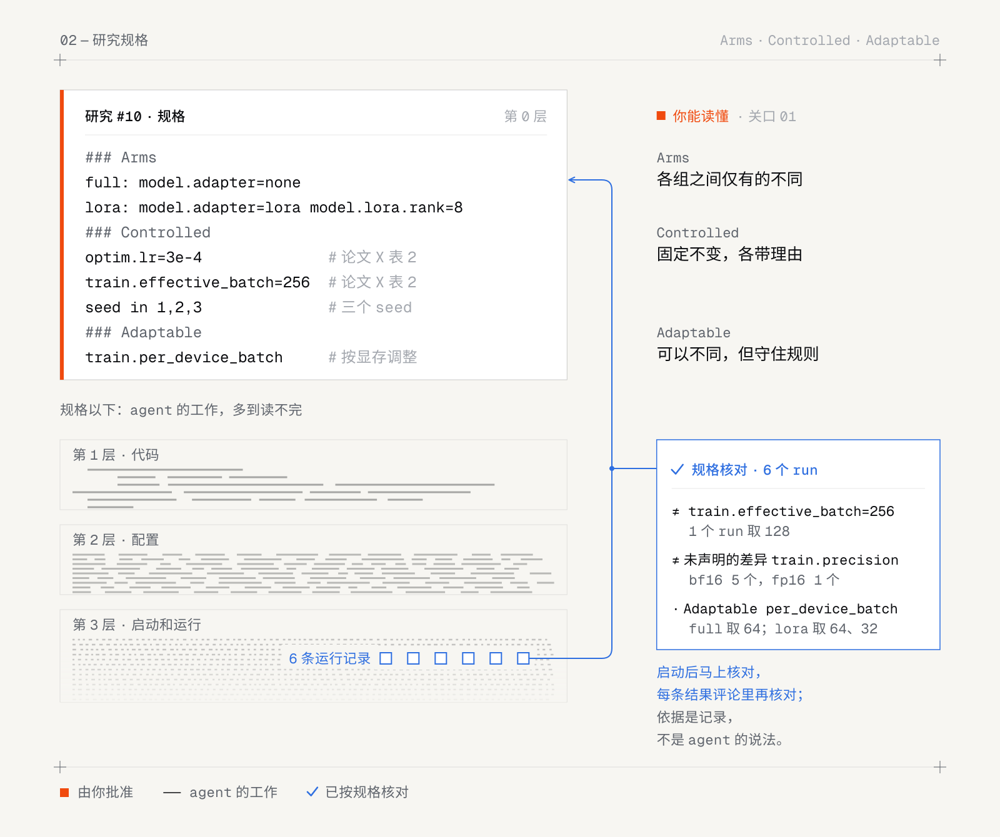

<picture>
  <source media="(prefers-color-scheme: dark)" srcset="assets/hero-zh-dark.svg">
  
</picture>

# 控制变量状态机协议（CVSM）

用编码 agent 跑控制变量实验的状态机协议。你写研究规格：各组之间改变哪些变量、固定哪些变量、哪些可以调整。agent 在 GitHub 的 issue 和 PR 上按状态机一步步实现和运行实验。每个 run 都记下实际生效的完整配置，由脚本对照规格核对，规格不允许的差异都会报出来。你只在四处做决定：发布、合并、预算、下结论。

CVSM 是一组复制进研究仓库就能用的文件，不是一个服务。状态放在 GitHub issue 里，步骤写在一个规则文件（`AGENTS.md`）和四个 skill 里，Claude Code 和 Codex 都能用。

  

[English](../README.md) · [文档](https://doem97.github.io/cvsm/zh-cn/) · [快速开始](https://doem97.github.io/cvsm/zh-cn/start/quick-start/)

## 每个 run 都对照研究规格核对

<picture>
  <source media="(prefers-color-scheme: dark)" srcset="assets/contract-zh-dark.svg">
  
</picture>

规格写明各组（arm）之间的不同、固定不变的设置（各带理由），以及可以调整的设置。它是你能真正读懂的那一层。规格以下的事都由 agent 去做，CVSM 按每个 run 自己的记录对照规格核对：启动后马上核对一次，每条结果评论里再核对一次。

## 把文件复制进你的仓库就能接入 CVSM

1. **复制这些文件**进你的仓库：

   ```
   git -C <cvsm clone> archive HEAD \
     AGENTS.md .agents .claude .codex .github scripts tests \
     ':!.github/workflows/pages.yml' | tar -x -C <你的仓库>
   ```

2. **填写 `AGENTS.md` 的 Project 一节**，每个字段一行：目录结构、测试命令、语言、受保护路径、Run 命令和运行记录。
3. **推到 `main`，再以仓库管理员身份运行 `bash scripts/setup.sh`**。它会建好 label，只允许 squash 合并，并给 main 加分支保护。

然后在仓库里打开 Claude Code 或 Codex，说"我们计划一下这个研究"。[接入指南](https://doem97.github.io/cvsm/zh-cn/guides/adopt/)讲了 `guard.toml`、`run.toml`、CI 和可选的机器账号。

## 文档逐项说明各个部分

- **入门**：[概览](https://doem97.github.io/cvsm/zh-cn/start/overview/) · [快速开始](https://doem97.github.io/cvsm/zh-cn/start/quick-start/) · [说话，不点页面](https://doem97.github.io/cvsm/zh-cn/start/talk-dont-click/)
- **概念**：[状态](https://doem97.github.io/cvsm/zh-cn/concepts/state/) · [关口与卡点](https://doem97.github.io/cvsm/zh-cn/concepts/gates-and-blockers/) · [审查](https://doem97.github.io/cvsm/zh-cn/concepts/review/) · [合并](https://doem97.github.io/cvsm/zh-cn/concepts/merging/) · [运行记录](https://doem97.github.io/cvsm/zh-cn/concepts/run-records/) · [研究规格](https://doem97.github.io/cvsm/zh-cn/concepts/study-spec/) · [原则](https://doem97.github.io/cvsm/zh-cn/concepts/principles/)
- **指南**：[接入](https://doem97.github.io/cvsm/zh-cn/guides/adopt/) · [计划一个研究](https://doem97.github.io/cvsm/zh-cn/guides/plan-a-study/) · [跑实验](https://doem97.github.io/cvsm/zh-cn/guides/run-experiments/) · [适配自己的环境](https://doem97.github.io/cvsm/zh-cn/guides/adapt-your-environment/) · [Claude Code 和 Codex](https://doem97.github.io/cvsm/zh-cn/guides/claude-code-and-codex/)
- **参考**：[AGENTS.md](https://doem97.github.io/cvsm/zh-cn/reference/agents-md/) · [skill](https://doem97.github.io/cvsm/zh-cn/reference/skills/) · [issue 表单](https://doem97.github.io/cvsm/zh-cn/reference/issue-forms/) · [guard](https://doem97.github.io/cvsm/zh-cn/reference/guard/) · [merge.py](https://doem97.github.io/cvsm/zh-cn/reference/merge-py/) · [run.py](https://doem97.github.io/cvsm/zh-cn/reference/run-py/) · [results.py](https://doem97.github.io/cvsm/zh-cn/reference/results-py/) · [接口](https://doem97.github.io/cvsm/zh-cn/reference/interfaces/)
- **项目**：[状态](https://doem97.github.io/cvsm/zh-cn/project/status/) · [用 CVSM 开发 CVSM](https://doem97.github.io/cvsm/zh-cn/project/built-with-cvsm/) · [许可证](https://doem97.github.io/cvsm/zh-cn/project/license/)
- **设计文档**：[docs/design/2026-10-16-harness-v1.md](design/2026-10-16-harness-v1.md)

CVSM v0.1.0 是预发布版本，1.0 之前接口仍可能变化。

## 许可证

[Apache-2.0](../LICENSE)。
